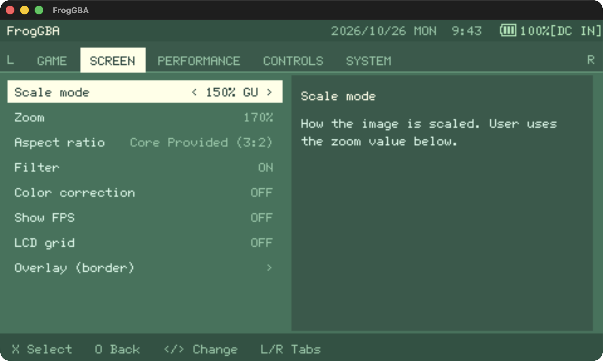
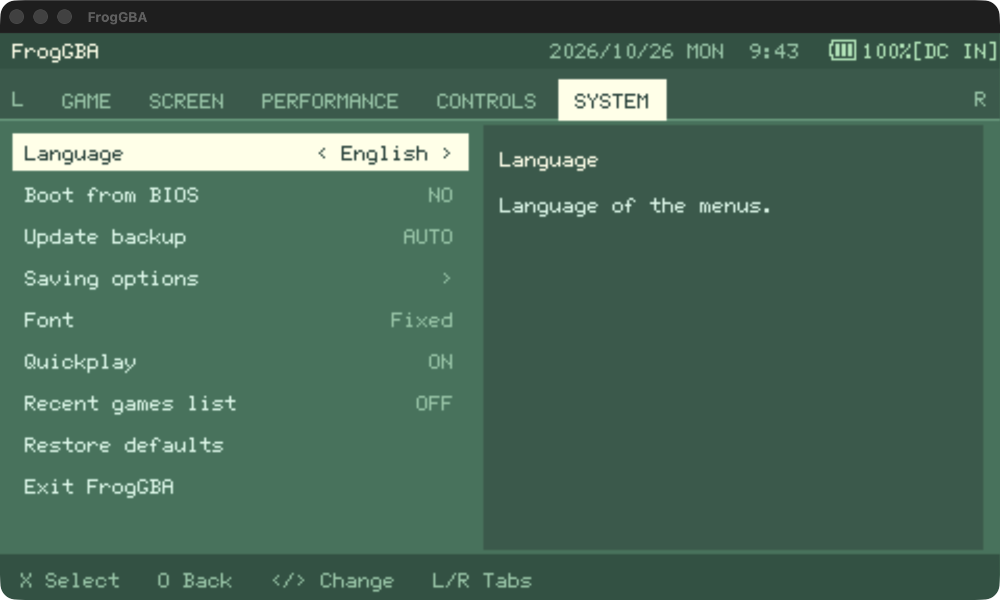

# FrogGBA - TempGBA mod by Prosty

## Download & Installation

**→ [Download the latest release here](https://github.com/tzubertowski/FrogGBA/releases) ←**

You need to have a CFW installed on your PSP. 
- Unzip the folder
- Copy the unzipped PSP folder into root of your PSP SD card
- Launch the emulator on the console

### TL;DR - Key Improvements in v0.2.2
• 🚀 **gpSP Kai Optimizations** - 10-25% performance gains in demanding titles
• 💯 **Full Speed Castlevania** - Water sections now run at 30+ FPS (was 15-20)
• 🎮 **Recent Games Menu** - Quick access to your last 10 played titles
• 🖼️ **Lightning-Fast Overlays** - Full-screen borders with zero performance impact
• ⚡ **No More Stutters** - Smart cache management eliminates micro-stutters
• 🎨 **Color Correction** - GPSP/Retro modes with optimized lookup tables
• 📐 **Aspect Ratio Options** - Core/Zoom/Stretch modes
• 💾 **Rock-Solid Stability** - Fixed exit crashes and save/load issues

## About
This is a modified version of TempGBA - a Game Boy Advance emulator for PlayStation Portable.

This mod is based on:
- [TempGBA](https://github.com/Nebuleon/TempGBA) by Nebuleon, Normmatt, and BassAceGold
- TempGBA4PSP-mod (TempGBA4PSP-26731020), http://www1.axfc.net/uploader/so/3063963

## PSP-1000 Edition (this branch)

Changes aimed at the original PSP-1000 (480x272 screen):

- **Tabbed menu**: Game / Screen / Performance / Controls / System tabs, switched with L and R. The file browser, sub-menus and start screen share the same look.
- **Quickplay start screen**: shows the last played game with a *Continue* button that resumes the auto save. Can be disabled in System. An optional *recent games* list (last 4, off by default) sits at the top of the game list.
- **Full French translation** of the interface (System > Language), with accented 6x12 bitmap fonts to choose from: Fixed, Terminus, Spleen.
- **Sharp bilinear filter** (Screen > Filter > SHARP): renders at 2x nearest-neighbour, then scales down bilinearly. Pixels stay crisp at non-integer zooms such as 150%.
- **LCD grid** (Screen > LCD grid): optional dark lines between GBA pixels (light / strong). Best at 200% zoom; not applied in the software 1.5x mode.
- **Performance**: larger dynamic recompiler cache for RAM code (768 KB), extra clock steps (383 / 403 / 423 MHz), sound calculation skipped when the volume is 0%, and profiling counters in the FPS overlay (SELECT + Square).

Settings are stored in the existing config file; configs from older versions keep working with default values for the new options.

### Settings tour

Screenshots taken from the menu (English interface). Switch tabs with **L / R**.

| | |
|---|---|
|  **Game** — return to game, save/load states with slot details, screen capture, cheats, reset, load another game |  **Screen** — scale mode, zoom, aspect ratio, filter (OFF / ON / SHARP), **LCD grid**, FPS counter, overlay borders |
|  **Performance** — CPU clock, frameskip, sound volume, compatibility mode, stack optimization |  **Controls** — button assignment, analog stick, X/O button mapping |
|  **System** — language (English / French), BIOS boot, backups, saving options, font, **Quickplay**, recent games list, restore defaults | |

## What's New in FrogGBA (Since v1.0)

### 🖼️ Overlay System (Enhanced in v0.2.2)
- **Lightning-Fast Loading**: Completely reworked overlay system loads instantly with zero performance impact
- **Full-Screen Borders**: Overlays can now stretch across the entire PSP display
- **Custom Overlays/Borders**: Render PNG overlays above the game window for bezels, borders, and custom frames
- **X/Y Offset Controls**: Position the game window anywhere on screen
- **Online Overlay Generator**: Convert PNG images to OVL format at [froggba.onrender.com](https://froggba.onrender.com)
- **Multiple Overlay Slots**: Store up to 10 different overlays and switch between them
- **RLE Compression**: Advanced compression handles pixel-dense designs without slowdown

### 📐 Display Options
- **Aspect Ratio Modes**:
  - **Core Provided (3:2)**: Original GBA aspect ratio with proper scaling
  - **Zoom (Fill Screen)**: Fills screen vertically, crops sides slightly
  - **Stretch (Full PSP)**: Stretches to fill entire 480×272 screen
- **Color Correction**: 
  - GPSP mode with optimized lookup tables
  - Retro mode for authentic GBA colors
  - Off for raw output
- **FPS Display**: SELECT + Square to toggle performance counter

### ⚡ Performance Optimizations
- **gpSP Kai Engine**: Implemented proven optimizations from the legendary gpSP Kai
  - Static translation caches for reduced memory fragmentation
  - Cache invalidation reduction for smoother frame pacing  
  - Optimized tile rendering pipeline matching gpSP Kai approach
- **Multi-Layer Rendering**: Fixed 4-layer Mode 0 bottlenecks
  - **Castlevania Series**: Water sections now run at full 30+ FPS (was 15-20 FPS)
  - **Golden Sun Series**: Battle effects and world map rendering improved
  - **Fire Emblem**: Large battle animations no longer cause slowdown
- **Memory Management**: Optimized for PSP architecture
  - 2MB ROM cache, 256KB RAM cache (reduced from previous oversized caches)
  - Pre-warmed cache lines reduce initial load stutters
- **Audio Processing**: Improved buffering reduces crackling and provides smoother sound
- **Volatile Memory Support**: Uses additional PSP RAM for maximum performance
  - Works on all PSP models (1000/2000/3000/Go)

### 💾 Save State Improvements
- **Auto Menu Exit**: Menu automatically closes after loading/saving states
- **Better Memory Management**: Temporarily frees overlay memory during save/load operations
- **File Validation**: Prevents crashes from corrupted or empty save states
- **Persistent Settings**: All new options are saved in config

### 🎮 Quality of Life  
- **Recent Games Menu**: Your last 10 played titles appear at the top when loading a game
- **Fast Forward**: SELECT + R toggles 2x/3x speed modes
- **Turbo Buttons**: Triangle and Square as dedicated turbo buttons
- **ROM Validation**: Prevents crashes when loading invalid files
- **Clean Exit**: Fixed BSOD crashes when exiting the emulator
- **Smooth Transitions**: Eliminated micro-stutters during level loading

### 🔧 Technical Improvements
- **PSP Cycle Batching**: Reduces dynamic recompiler overhead
- **Cache Invalidation Reduction**: Conservative cache management
- **Timer Prescaling Optimization**: Better audio/video sync
- **Smart Memory Allocation**: Dynamic allocation reduces static memory usage by ~550KB

### 📈 Performance Impact (v0.2.2)
- **Castlevania Series**: Water sections 15-20 FPS → 30+ FPS (100% speed achieved!)
- **Golden Sun Series**: Battle effects now run without slowdown
- **Fire Emblem**: Large animations no longer cause frame drops
- **Kirby Amazing Mirror**: Eliminated level transition stutters
- **Overall**: 10-25% improvement in demanding titles, consistent 60 FPS in most games

## 🎨 How to Use Custom Overlays

### Creating Overlays
1. **Visit the Online Generator**: Go to [froggba.onrender.com](https://froggba.onrender.com)
2. **Upload Your PNG**: 
   - Image must be exactly 480×272 pixels (PSP screen size)
   - Transparent areas will show the game
   - Opaque areas will be the border/bezel
3. **Download OVL File**: Click convert and download the generated .ovl file
4. **Install on PSP**:
   - Copy the .ovl file to `/PSP/GAME/FrogGBA/overlays/` on your Memory Stick
   - Files will appear in the Overlay menu in-game

### Using Overlays in FrogGBA
1. Press **HOME** during gameplay to open the menu
2. Navigate to **Overlay Settings**
3. Select your overlay from the list
4. Adjust X/Y offset if needed to position the game window
5. Enable/disable overlays with the toggle option

### Tips for Best Results
- Design overlays with a transparent center area for the game (240×160 minimum)
- Use PNG transparency for see-through areas
- Keep border designs simple to avoid hitting the 30,000 pixel limit
- Test different aspect ratios with your overlays (Core/Zoom/Stretch)

## Original TempGBA Features

- Added gpsp kai's cheats function
- Added Chinese language support  
- Added restore function
- New menu icon
- Imported code from TempGBA-mod-dstwo-26750220
- Modern PSP SDK compatibility
- Docker-based build system
