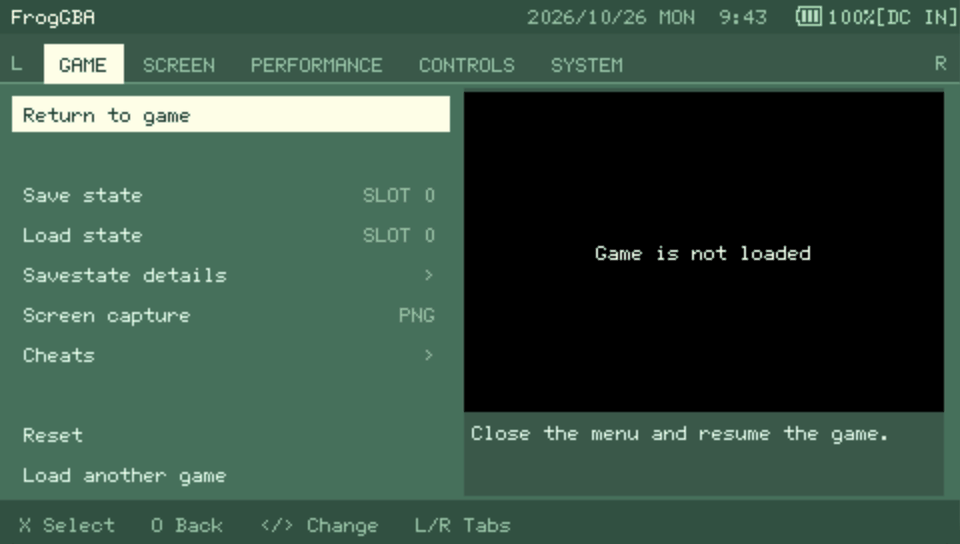
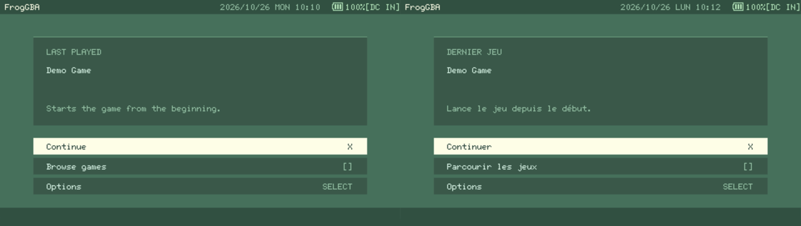
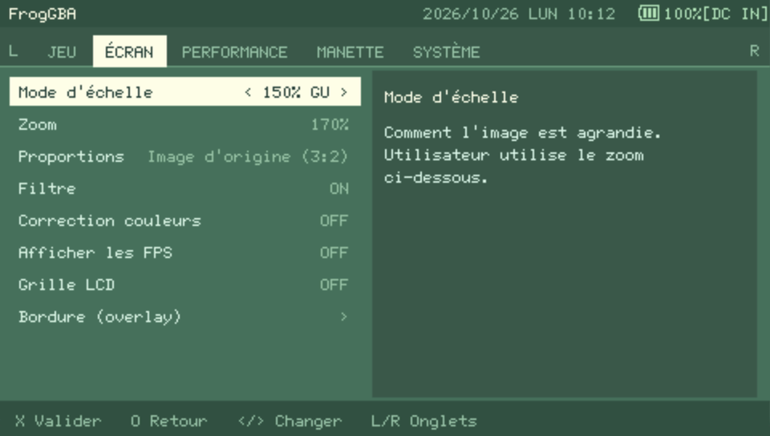
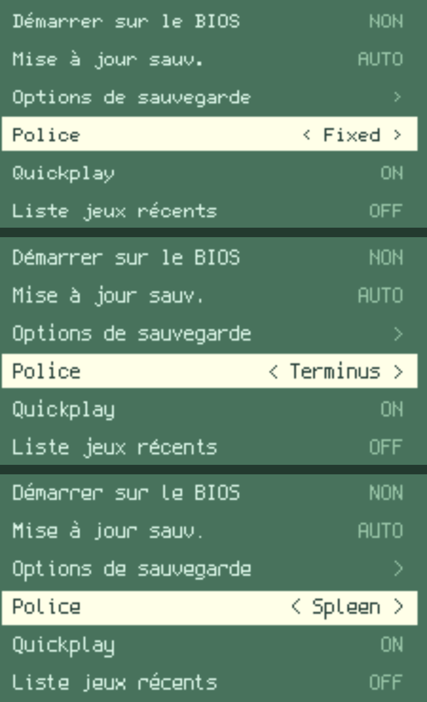

# FrogGBA — PSP-1000 Edition

A Game Boy Advance emulator for the PlayStation Portable, tuned for the original PSP-1000 (480x272 screen).
Based on FrogGBA, itself a mod of TempGBA / gpSP kai.

  

## Features

- **Tabbed menu** — Game, Screen, Performance, Controls and System tabs, switched with L / R. The file browser and sub-menus share the same look.
- **Quickplay** — start screen with your last game and a *Continue* button that resumes the auto save. Can be turned off. An optional list of the last 4 games sits at the top of the game list.
- **French and English interface**, with three bitmap fonts to choose from (Fixed, Terminus, Spleen).
- **Sharp bilinear filter** — crisp pixels at non-integer zooms such as 150%.
- **LCD grid** — optional dark lines between GBA pixels (light / strong).
- **Performance work for the PSP-1000** — larger recompiler cache, extra clock steps (383 / 403 / 423 MHz), profiling counters in the FPS overlay (SELECT + Square).
- Overlays (borders), aspect ratio modes, save states, cheats and analog stick support from the original project.

## Quickplay

Pick up where you left off: the start screen shows your last game with a **Continue** button (resumes the auto save), a game browser and the options. It can be turned off in *System*.

  

## French interface

The whole interface is available in French (*System > Language*), accents included.

  

## Fonts

Three 6x12 bitmap fonts with real accents, selectable in *System > Font*: **Fixed** (default), **Terminus** and **Spleen**.

  

## Installation

1. Download the latest build from [Releases](../../releases) (currently a **beta**), unzip it and copy the `PSP` folder to the root of your memory stick. A custom firmware is required.
2. Put your own `gba_bios.bin` in `PSP/GAME/FrogGBA/` and your game files in `PSP/GAME/FrogGBA/roms/`.
3. Launch FrogGBA from the PSP game menu.

**No BIOS and no game is included in this repository.** You must use a BIOS and games that you legally own.

## Building

See [BUILD_INSTRUCTIONS.md](BUILD_INSTRUCTIONS.md) (Docker based).

## Credits and license

- [TempGBA](https://github.com/Nebuleon/TempGBA) by Nebuleon, Normmatt and BassAceGold
- TempGBA4PSP-mod
- gameplaySP kai by Exophase and takka
- FrogGBA by Prosty ([tzubertowski/FrogGBA](https://github.com/tzubertowski/FrogGBA))

This is a derivative work; see [LICENSE](LICENSE) for the terms. Game Boy Advance is a trademark of Nintendo, and this project is not affiliated with or endorsed by Nintendo or Sony.
